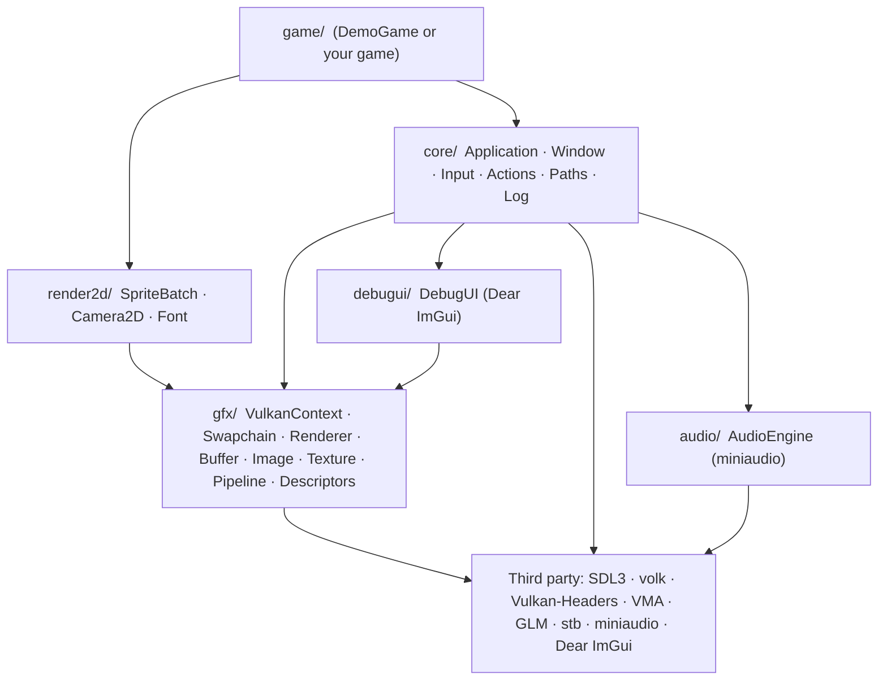
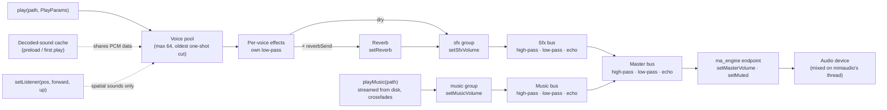
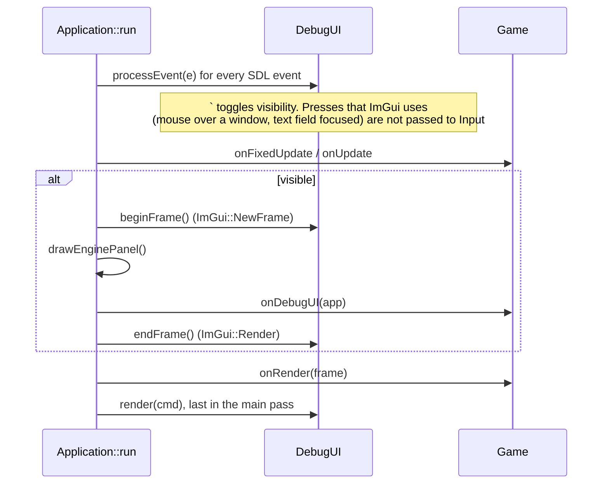
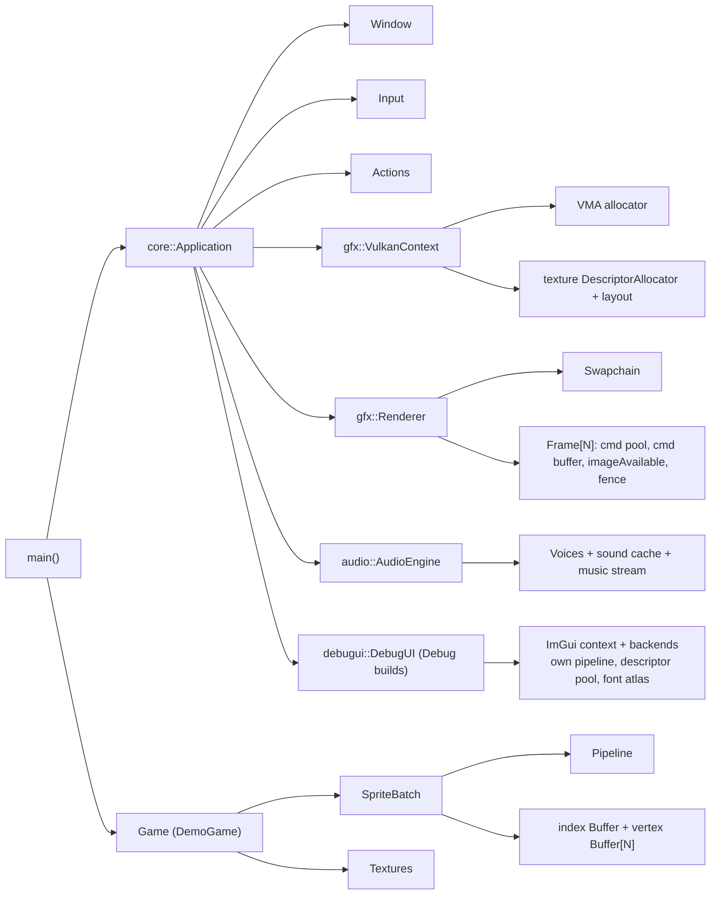
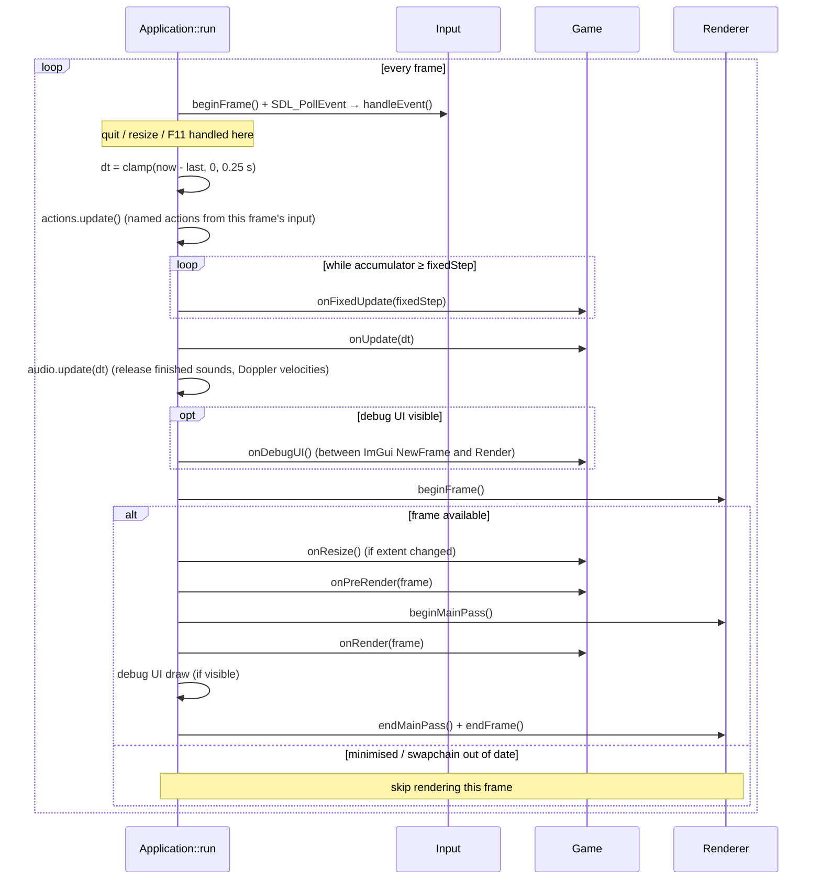
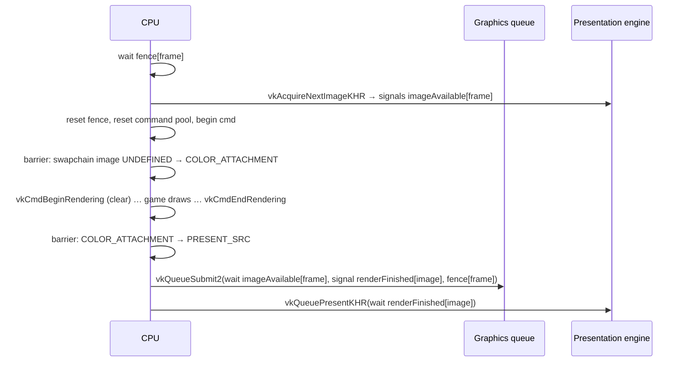
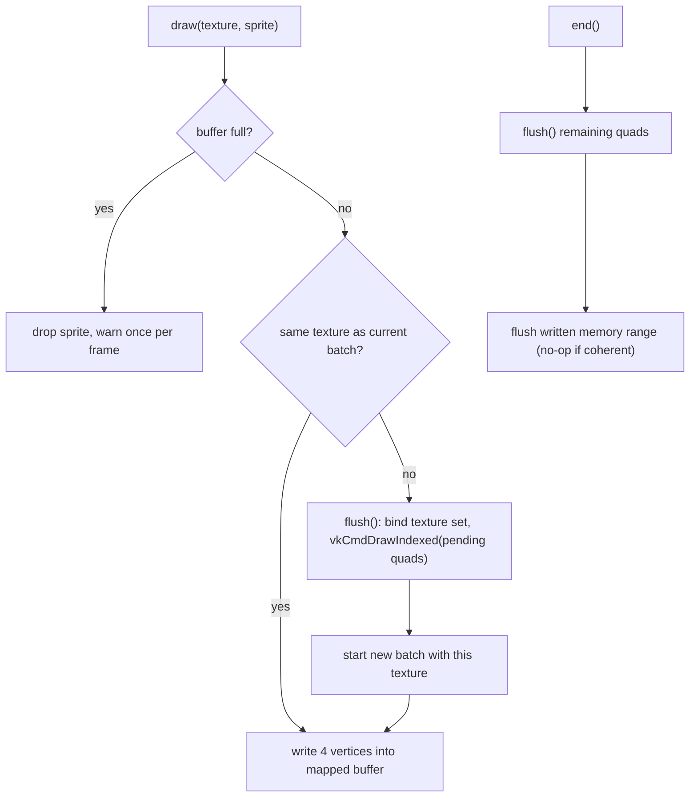
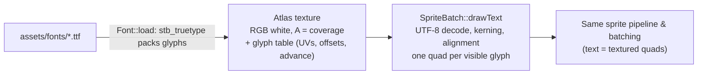
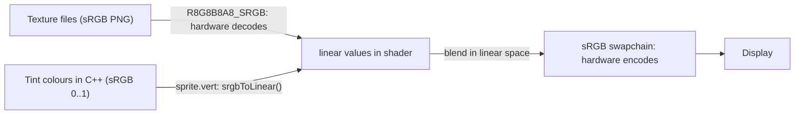

# Game2D — Architecture Overview

> Status: describes the framework as of version 0.1.0.
> Audience: anyone extending the framework or building a game on top of it.
> Diagrams use [Mermaid](https://mermaid.js.org/); they render on GitHub/GitLab and in
> VS Code with the *Markdown Preview Mermaid Support* extension.

---

## 1. Purpose and design goals

Game2D is a minimal, engine-free foundation for 2D games written in C++20, targeting
**Windows, Linux and Steam Deck** with **Vulkan 1.3** for graphics.

| Goal | How it is achieved |
|---|---|
| You own and understand all the code | Small codebase (~4k lines including comments), no engine or framework; only thin, well-known libraries |
| Cross-platform from day one | SDL3 hides OS differences; no platform `#ifdef`s in game code |
| Modern, simple Vulkan | Vulkan 1.3 *dynamic rendering* (no render passes / framebuffers) and *synchronization2* |
| Hard to misuse | RAII, move-only wrappers for every GPU object; fatal errors are loud and descriptive |
| Fast iteration | Shaders and assets rebuild/copy automatically; new source files are picked up by CMake |
| Shippable | Static SDL3, Vulkan loaded at runtime, executable finds its files relative to itself |

Non-goals: being a general-purpose engine, an editor, a scene graph, or an ECS. Those are
decisions for the game built on top.

---

## 2. Layered structure

The code is split into layers. Each layer only depends on the layers below it.



| Layer | Namespace | Responsibility | Shared with Game3D |
|---|---|---|---|
| `src/core` | `core` | Program lifetime, main loop, window, input, input actions, file paths, logging | Yes, identical |
| `src/gfx` | `gfx` | Everything Vulkan: device, swapchain, frames, memory, textures, pipelines | Yes, identical |
| `src/audio` | `audio` | Sound effects, music, 3D sound (miniaudio) | Yes, identical |
| `src/debugui` | `debugui` | In-game debug overlay (Dear ImGui) | Yes, identical |
| `src/render2d` | `render2d` | 2D rendering on top of `gfx`: sprites, cameras, text | Yes, identical (Game3D uses it for its HUD) |
| `src/game` | (global) | The actual game; replaceable | No |

> `core` and `gfx` reference each other in one place only: `Application` owns the
> `VulkanContext` and `Renderer`, and `Window` creates the Vulkan surface. `gfx` itself
> depends only on `core::Window` (for the surface/size) and `core/Log.h`.

### Source map

```
src/
  main.cpp                    builds AppConfig, creates Application + Game, runs
  core/
    Application.h/.cpp        Game interface, AppConfig, main loop, fixed timestep
    Window.h/.cpp             SDL window, pixel size, fullscreen, Vulkan surface
    Input.h/.cpp              keyboard / mouse / gamepad state per frame
    Actions.h/.cpp            named input actions: bindings, rebinding, button prompts
    Paths.h/.cpp              basePath(), shaderPath(), assetPath()
    Log.h                     LOG_* macros, core::fatal()
  audio/
    Audio.h/.cpp              AudioEngine: effects, music, 3D listener, mixer
    Effects.h/.cpp            effect nodes: filters, echo, reverb, smooth glides (internal)
    MiniaudioImpl.cpp         miniaudio + stb_vorbis implementation unit
  debugui/
    DebugUI.h/.cpp            Dear ImGui setup, input sharing, rendering, textures
  gfx/
    VkCommon.h                single Vulkan include (vulkan.h + volk + VMA), VK_CHECK
    Implementations.cpp       VMA, stb_image and stb_truetype implementation units
    VulkanContext.h/.cpp      instance, debug messenger, GPU selection, device, VMA
    Swapchain.h/.cpp          swapchain + image views + per-image semaphores
    Renderer.h/.cpp           frames in flight, acquire/submit/present, main pass
    Buffer.h/.cpp             VkBuffer + VMA allocation
    Image.h/.cpp              VkImage + view, imageBarrier() helper
    Texture.h/.cpp            Image + sampler + descriptor set, mip generation
    Pipeline.h/.cpp           Pipeline (RAII) + PipelineBuilder, SPIR-V loading
    Descriptors.h/.cpp        layout builder, growable allocator, writer
  render2d/
    Camera2D.h/.cpp           orthographic camera, screen <-> world
    SpriteBatch.h/.cpp        batched textured quads, drawText
    Font.h/.cpp               TrueType font baked into an atlas (stb_truetype)
    Animation.h/.cpp          SpriteSheet (grid or Aseprite JSON), clips, Animator
  game/
    DemoGame.h/.cpp           example game
shaders/                      GLSL sources (compiled to SPIR-V at build time)
  sprite.vert, sprite.frag    sprites and text
  imgui.frag                  Dear ImGui's fragment shader, sRGB-correct (debug UI)
assets/                       runtime data (copied next to the executable)
  fonts/                      Roboto Medium + its licence
  sounds/                     demo sound effects (CC0) + README
cmake/                        Dependencies.cmake, Shaders.cmake
```

---

## 3. Module reference

### 3.1 core

**`core::Application`** owns every long-lived system and runs the main loop.
Construction order (and reverse destruction order) is significant:

1. `SDL_Init(VIDEO | GAMEPAD)`
2. `Window` → 3. `Input` → 4. `gfx::VulkanContext` → 5. `gfx::Renderer` →
   6. `audio::AudioEngine` → 7. `debugui::DebugUI` (if enabled)

Its destructor tears down in exactly the reverse order, then calls `SDL_Quit()`.

**`core::Game`** is the interface a game implements. Every hook is optional:

| Hook | When | Typical use |
|---|---|---|
| `onInit` | once, after the GPU is ready | load textures, create `SpriteBatch`, set up state |
| `onFixedUpdate(dt)` | 0..n times per frame at a fixed rate (default 60 Hz) | gameplay simulation, physics |
| `onUpdate(dt)` | once per frame, real frame time | input handling, camera, animation |
| `onPreRender(frame)` | before the main render pass begins | uploads, off-screen passes, compute |
| `onRender(frame)` | inside the main pass (cleared, viewport set) | draw calls |
| `onResize(w, h)` | swapchain size changed | resize render targets / UI |
| `onDebugUI` | once per frame after `onUpdate`, only while the debug UI is visible | ImGui windows: stats, tweaks, buttons |
| `onShutdown` | after `vkDeviceWaitIdle`, before teardown | destroy GPU resources |

**`core::AppConfig`** groups configuration: window description, `gfx::RendererConfig`,
`audio::AudioDesc`, `debugui::DebugUIDesc`, fixed timestep, validation on/off,
FPS-in-title and fullscreen hotkeys.

**`core::Window`** wraps `SDL_Window` (created with `SDL_WINDOW_VULKAN |
SDL_WINDOW_HIGH_PIXEL_DENSITY`). It reports the *pixel* size (high-DPI aware), supplies
the Vulkan instance extensions SDL needs, and creates the `VkSurfaceKHR`.
Fullscreen is borderless "desktop" fullscreen (what gamescope on the Deck expects).

**`core::Input`** turns SDL events into per-frame state:

- `down` / `pressed` / `released` for keys (by scancode, layout-independent), mouse
  buttons and gamepad buttons. Presses are latched from events, so a tap shorter than a
  frame is never lost.
- Mouse position/delta in framebuffer pixels, wheel, relative mouse mode.
- First connected gamepad, with hot-plug fallback; radial dead zone on sticks; triggers
  0..1; rumble. Steam Deck controls arrive as a standard gamepad through Steam Input.
- Keys and buttons are released on focus loss to avoid "stuck" input.

**`core::Actions`** (`app.actions()`) sits on top of `Input`: the game names what the player
does ("jump", "left") and asks about that name, never about a key.

- `define(name, {bindings})` sets the default inputs. A `Binding` is a key, mouse button,
  gamepad button, or one direction of a stick or trigger (`Binding::axis(axis, ±1)`).
- Reading: `down`, `pressed` (taps shorter than a frame still count), `released`, `value`
  (0..1, analog for sticks and triggers) and `vector(left, right, up, down)` (a direction
  of length ≤ 1; analog with a stick). Unknown names log a warning once and read as idle.
- `consume(name, bufferSeconds = 0.15)` is a **buffered press** for `onFixedUpdate`: the
  press is kept until a step uses it (or it expires), so it's never lost between steps or
  used twice.
- Rebinding: `addBinding`, `removeBinding`, `setBindings`, `resetToDefaults`,
  `resetAllToDefaults`, `actionsUsing` (clashes) and `capture()` (the first input pressed
  this frame, for "press a key" screens). `saveBindings()`/`loadBindings()` convert to and
  from JSON text such as `{"jump": ["key:Space", "pad:a"]}`.
- Prompts: `lastDevice()` switches on whatever the player touched last (a key, click,
  button or stick), and `prompt(name)` names that device's first binding: "Space", "A",
  "Cross", "Left Stick Up". Gamepad names follow the pad's own labels (Xbox and Steam Deck
  A/B/X/Y, PlayStation Cross/Circle/Square/Triangle, Nintendo).
- `Application` updates it once per frame, after events and **before** `onFixedUpdate`, so
  both hooks see this frame's presses.

**`core::Paths`** resolves everything relative to the executable directory
(`SDL_GetBasePath()`): `shaderPath("x.vert.spv")` → `<exe>/shaders/…`,
`assetPath("textures/x.png")` → `<exe>/assets/…`. The working directory never matters.

**`core/Log.h`** maps `LOG_INFO/WARN/ERROR/DEBUG` onto SDL's logger and provides
`core::fatal(fmt, …)`, which logs, shows a message box and aborts (see §9).

### 3.2 gfx

**`gfx::VulkanContext`**: one per application.

- Loads Vulkan at runtime through **volk** (`volkInitialize`); nothing links against
  `vulkan-1.dll` / `libvulkan.so`.
- Creates the instance (API 1.3), optionally with `VK_LAYER_KHRONOS_validation` and a
  `VK_EXT_debug_utils` messenger.
- Picks a GPU: must support Vulkan 1.3, `VK_KHR_swapchain`, `dynamicRendering`,
  `synchronization2`, and graphics + present queues. Scores discrete > integrated and
  prefers a single queue family for both.
- Creates the device (enables anisotropy and `fillModeNonSolid` when available) and the
  **VMA** allocator.
- Provides `immediateSubmit(lambda)` for blocking, load-time GPU work (uploads).
- Owns the shared **texture descriptor set layout** (binding 0 = combined image sampler,
  fragment stage) and a growable, free-able `DescriptorAllocator` for texture sets.

**`gfx::Swapchain`**: creation and recreation of the swapchain, its image views and
one *render-finished* semaphore **per swapchain image**.

- Format: `B8G8R8A8_SRGB` / `R8G8B8A8_SRGB` with sRGB non-linear colour space.
- Present mode: FIFO when vsync is on; otherwise MAILBOX → IMMEDIATE → FIFO.
- Image count: at least 3 (triple buffering), clamped to the surface limits.

**`gfx::Renderer`**: the frame loop on the GPU side (details in §5).
Configured by `RendererConfig { vsync, depthBuffer, clearColor, framesInFlight }`.
Game2D uses `depthBuffer = false`: draw order determines layering.

**`gfx::Buffer`**: `VkBuffer` + `VmaAllocation`. `MemoryUsage::GpuOnly`,
`CpuToGpu` (persistently mapped, sequential write) or `GpuToCpu` (mapped, cached).
`Buffer::createWithData()` uploads via a staging buffer. `write()` / `flush()` for
mapped buffers.

**`gfx::Image`**: `VkImage` + view + allocation for textures and render targets.
`imageBarrier()` records a single sync2 image barrier/layout transition.

**`gfx::Texture`**: a sampled RGBA8 image with its own sampler and **its own
descriptor set**, so a texture can be bound with a single call and needs no lookup tables.
Created from pixels (`fromPixels`), from a file via stb_image (`fromFile`) or as a solid
colour (`solid`). `TextureDesc` selects sRGB vs UNORM, mipmaps (generated on the GPU by
blitting), filtering (`NEAREST` for pixel art) and wrap mode.

**`gfx::Pipeline` / `gfx::PipelineBuilder`**: fluent builder for graphics pipelines
using dynamic rendering (`VkPipelineRenderingCreateInfo` with attachment formats).
Viewport and scissor are always dynamic state. Blend modes: `Opaque`, `Alpha`,
`PremultipliedAlpha`, `Additive`.

**`gfx::Descriptors`**: `DescriptorLayoutBuilder`, `DescriptorAllocator` (adds a new pool
whenever the current one is exhausted; optional per-set freeing) and `DescriptorWriter`
(batches `vkUpdateDescriptorSets`).

### 3.3 render2d

**`render2d::Camera2D`**: orthographic camera.

- World units are "pixels at zoom 1", **+X right, +Y down**.
- `position` (world point at screen centre), `zoom`, `rotation` (radians).
- `referenceHeight`: when non-zero, the camera always shows that many world units
  vertically, so the game looks the same at 720p, Steam Deck 800p or 4K.
- `screenToWorld` / `worldToScreen` for mouse picking, `visibleBounds` for culling.

**`render2d::SpriteBatch`**: batched textured quads (details in §6).
API: `begin(frame, viewProj)`, `draw(texture, Sprite)`, `draw(texture, pos, scale, rot,
color)`, `drawRect`, `drawRectOutline`, `drawLine`, `end()`. `UvRect` handles
atlas/sprite-sheet sub-rectangles and flipping. `stats()` reports sprites and draw calls.

**`render2d::Font`**: a TrueType/OpenType font baked into a texture atlas (details in
§6.4). `Font::load(gpu, path, FontDesc)` rasterises a contiguous range of characters
(default: printable ASCII + Latin-1) at `FontDesc::pixelHeight` (default 48 px).
`measure(text, size)`, `lineHeight(size)` and `ascent(size)` support layout. Text is drawn
with `SpriteBatch::drawText(font, utf8, position, TextStyle)`; `TextStyle` sets size,
colour, alignment (`Left`/`Center`/`Right`), line spacing and pixel snapping.

**`render2d::SpriteSheet` / `Animator`** (`render2d/Animation.h`): sprite-sheet
animation. A `SpriteSheet` owns a texture, its frames (UV rectangle, pixel size, default
duration) and named `AnimationClip`s (frame indices, per-frame durations, `Loop` / `Once` /
`PingPong`, and named events on frames). Sheets come from a grid (`loadGrid`, clips added
in code) or from **Aseprite's JSON export** (`loadAseprite`: tags become clips with their
frame durations and directions; parsed with nlohmann/json, keeping file order for "Hash"
exports). They load with nearest filtering and no mipmaps, so neighbouring frames never
blend. An `Animator` plays one clip for one object: `play` (a no-op if that clip is
already playing, so the game can state the wanted clip every step), `update(dt)` (handles
several frames per step, fires the events of every frame entered, and has a tiny tolerance
so 60 Hz steps change frames exactly on time), `uv(flipX)`, `finished()`,
`eventFired(name)`, and a `speed` multiplier. It points at its sheet, which must stay alive
and in place.

### 3.4 audio

**`audio::AudioEngine`** plays sound effects, music and 3D positional sound with
[miniaudio](https://miniaud.io). `Application` creates it after the renderer (from
`AppConfig::audio`, an `audio::AudioDesc`) and games reach it with `app.audio()`. The
module depends only on miniaudio, GLM and `core/Log.h`; it never touches Vulkan.



- **Sound effects** are decoded into memory the first time a file is played (or by
  `preload`) and cached, so later plays start instantly and share the same data. Each
  `play` returns a `SoundHandle` (a unique id that is never reused); stale handles are
  ignored, so a game can keep handles without tracking when sounds end.
- **`PlayParams`**: `volume`, `pitch`, `pan`, `loop`, for 3D sounds `spatial`,
  `position`, `minDistance`, `maxDistance`, `rolloff` (inverse-distance attenuation), and
  the sound's own effects: `lowPassHz` and `reverbSend`, and its `doppler` amount.
- **3D sound** is relative to a single listener set with `setListener(position, forward,
  up)`, in the same right-handed, +Y-up axes as `Camera3D`. Use mono files for spatial
  sounds.
- **Doppler.** Spatial sounds rise in pitch as they approach the listener and fall as
  they move away (miniaudio's spatializer, using the OpenAL formula). In `update(dt)`,
  each spatial sound's and the listener's velocity is estimated from how far it moved
  since the last frame (smoothed over ~0.1 s; a jump faster than sound counts as a
  teleport, not motion), unless the game sets it with `setVelocity` /
  `setListenerVelocity`. Velocities are capped at 0.3 × speed of sound ÷ factor, because
  the formula divides by (speed of sound − factor × speed). Settings: `speedOfSound` (in
  world units/s; 343 = metres) and `dopplerFactor` globally, `PlayParams::doppler` per
  sound. `dopplerPitch(handle)` reports the current shift. Non-spatial sounds and music
  never shift. 2D games get Doppler by playing sounds as spatial in the X/Y plane.
- **Music** is one streamed track at a time (`playMusic`, `stopMusic`, `pauseMusic`,
  `resumeMusic`). Starting a new track fades the old one out over
  `MusicParams::fadeOutPreviousSeconds`. Music is never spatialised.
- **Mixer**: master, sfx and music volumes, plus `setMuted`, which silences everything
  without changing the volumes.
- **Effects** (`audio/Effects.h/.cpp`, internal). Each bus (`Bus::Sfx`, `Bus::Music`,
  `Bus::Master`) has a custom miniaudio node with a high-pass (12 dB/octave), a
  low-pass (24 dB/octave) and an echo (a stereo delay line with feedback, up to 2 s). Every
  playing sound effect has its own node with a low-pass and a send to the shared
  **reverb** (verblib, a Freeverb implementation bundled with miniaudio). The reverb's
  output joins the sound-effects group, so the effects volume and the Sfx bus filters
  apply to the tail too; music never reaches it.
- **Glides.** Setters store a target that the audio thread approaches exponentially
  (`SmoothParam`, updated every 64 frames; filters glide in log-frequency so a sweep sounds
  even). Nothing clicks, and the game thread never waits on the audio thread. A filter at
  its "off" value is skipped entirely, and the reverb does no work while its level is 0.
  The bus and reverb nodes keep processing after their inputs stop, so echo and reverb
  tails finish naturally.
- **`update(dt)`** is called by `Application` once per frame, after `onUpdate`, with the
  frame time. It releases voices that have finished playing and updates the Doppler
  velocities; nothing else in the game loop depends on audio.
- **No device, no problem.** If no output device can be opened (or `GAME_AUDIO=0` is
  set, or `AudioDesc::enabled` is false), a warning is logged and every call becomes a
  no-op. `AudioDesc::noDevice` runs the mixer without a device so tests can pull samples
  with `readFrames()`.
- Formats: WAV, FLAC and MP3 (built into miniaudio) and OGG Vorbis (stb_vorbis, shipped
  with miniaudio). The implementation is compiled once in `audio/MiniaudioImpl.cpp`.
- **Threading.** Call the API from the game thread. Mixing runs on miniaudio's device
  thread; miniaudio handles the synchronisation.

---

### 3.5 debugui

**`debugui::DebugUI`** is an in-game debug overlay built on
[Dear ImGui](https://github.com/ocornut/imgui) with its SDL3 and Vulkan backends.
`Application` creates it after the audio engine when `AppConfig::debugUI.enabled` is
set, which is the default in Debug builds only. Release builds don't create it at all,
so `app.debugUI()` returns `nullptr` there.



- **Games add windows in `Game::onDebugUI`**, called once per frame after `onUpdate`, only
  while the UI is visible. Including `core/Application.h` brings in `imgui.h`.
- **Input sharing.** Every event goes to ImGui first. A mouse-button press or wheel event
  over a debug window, or a key press while a text field has focus, is not passed to
  `core::Input`. Releases always are, so nothing gets stuck down. The toggle key
  (`DebugUIDesc::toggleKey`, default the key below Esc) is consumed by the debug UI.
- **Rendering.** ImGui's Vulkan backend draws with its own pipeline inside our main
  pass (dynamic rendering, created with the swapchain colour format and the renderer's
  depth format). It calls Vulkan through volk (`IMGUI_IMPL_VULKAN_USE_VOLK`). Its vertex
  buffers are per frame in flight. When the font atlas changes, the backend uploads it with
  its own command buffer and waits for the queue: a small, rare stall.
- **Colour.** ImGui's colours are sRGB values. Our swapchain is sRGB, so it expects linear
  values. `shaders/imgui.frag` replaces ImGui's fragment shader with one that converts
  vertex colours to linear, so ImGui looks exactly as designed.
- **Size.** The style and the font scale with the display's scale setting (e.g. 150% on
  Windows) times `DebugUIDesc::scale`. The font is the project's Roboto Medium if present;
  ImGui renders font glyphs on demand, so text stays sharp at any size.
- **Textures.** `DebugUI::texture(gfx::Texture)` registers a texture with the ImGui
  backend once (a descriptor set from its own pool, room for 64) and returns an
  `ImTextureID` for `ImGui::Image`.
- **The Engine panel** (`Application::drawEnginePanel`) shows a frame-time graph, GPU and
  swapchain details, vsync/fullscreen toggles, audio status and volumes, input devices, and
  a switch for ImGui's demo window. Turn it off with `DebugUIDesc::showEnginePanel`.
- `imgui.ini` is not written (`io.IniFilename = nullptr`), so window positions reset each
  run and nothing is written next to the executable.

---

## 4. Object ownership and lifetime



Rules:

- **All GPU wrappers are RAII and move-only** (`Buffer`, `Image`, `Texture`, `Pipeline`).
  They hold a pointer to the `VulkanContext` and destroy themselves in their destructor.
- In `main()`, the `Application` is declared before the `Game`, so the game (and every
  GPU object it owns) is destroyed first, while the device still exists.
- `Application::run()` calls `vkDeviceWaitIdle` before `onShutdown`, so destroying
  resources there or in the game's destructor is safe.
- **During gameplay**, destroying a resource that an in-flight frame may still use is an
  error. Call `renderer.waitIdle()` first, or keep resources alive for
  `framesInFlight` frames. (A deferred-deletion queue is a natural future addition.)
- In debug builds, VMA asserts at shutdown if any `Buffer`/`Image` leaked.

---

## 5. Main loop and frame lifecycle

### 5.1 CPU timeline



- **Fixed timestep with interpolation.** Simulation runs at `AppConfig::fixedTimestep`
  (1/60 s). `interpolationAlpha()` (0..1) tells how far the real time is between the last
  two fixed steps; render `mix(previousState, currentState, alpha)` for smooth motion on
  any refresh rate (144 Hz, 40 Hz Deck mode…). `DemoGame` does this for the player.
- `dt` is clamped to 0.25 s so a breakpoint or hitch doesn't cause a spiral of catch-up.
- When minimised the loop sleeps and resets the clock instead of rendering.

### 5.2 GPU frame (Renderer)



**Synchronisation objects**

| Object | Count | Purpose |
|---|---|---|
| Fence `inFlight` | per frame in flight (2) | CPU waits before reusing that frame's command buffer and per-frame buffers |
| Semaphore `imageAvailable` | per frame in flight | acquire → rendering may start writing the image |
| Semaphore `renderFinished` | **per swapchain image** | rendering done → presentation may read the image |
| Command pool + buffer | per frame in flight | reset as a whole each frame (cheap) |

`renderFinished` is per *image*, not per frame, because the presentation engine may still
hold a semaphore after the frame's fence signals; tying it to the image guarantees it is
not reused too early.

**Swapchain recreation** is triggered by a pixel-size change event, `VK_SUBOPTIMAL_KHR`
/ `VK_ERROR_OUT_OF_DATE_KHR` from acquire or present, or a vsync toggle. It waits for the
device to go idle, then recreates the swapchain (passing the old one as `oldSwapchain`) and
the depth buffer, if any. Simple and robust; resizing is rare enough that the idle wait does
not matter.

`FrameContext` is what the game receives: `cmd`, `frameIndex` (index your per-frame
resources with it), `imageIndex`, `frameNumber` and `extent`.

---

## 6. Sprite batching

### 6.1 Data layout

```
Vertex (20 bytes)          Quad = 4 vertices, 6 indices
  vec2  position (world)     0 ─── 1        indices: 0 1 2  2 3 0
  vec2  uv                   │  ╲  │
  u32   color (RGBA8 sRGB)   3 ─── 2
```

- **Index buffer**: static, device-local, `uint32`, generated once for
  `maxSpritesPerFrame` quads (default 20 000).
- **Vertex buffers**: one per frame in flight, host-visible and persistently mapped. The
  CPU writes quads straight into mapped memory; no per-frame allocation or staging.
- **Push constant**: one `mat4` view-projection (64 bytes).
- **Descriptor set 0**: the texture's own set (`Texture::descriptorSet()`).

### 6.2 Batching rules



- Consecutive sprites with the same texture become **one draw call**. Draw order is
  preserved, so layering = submission order. Group draws by texture, or use atlases, to
  minimise draw calls.
- `begin()/end()` may be used **multiple times per frame** (e.g. world camera, then HUD in
  screen space). Within a frame, later batches append after earlier ones in the same vertex
  buffer; the write cursor resets when `frame.frameNumber` changes.
- Sprite corners are transformed on the CPU (origin/pivot, rotation, size), so the shader
  stays trivial and any number of differently transformed sprites can share a draw.

### 6.3 Shaders

`sprite.vert` transforms by the view-projection and converts the vertex colour from sRGB
to linear. `sprite.frag` outputs `texture(uv) * color`. Pipeline: alpha blending, no depth,
no culling (so flipped/rotated sprites always render).

### 6.4 Text



- **Baking (load time).** `stbtt_PackFontRange` rasterises every character in the range into
  the smallest square atlas that fits (256 to 4096 px), with 2× horizontal oversampling for
  smoother sub-pixel placement. Coverage goes into the alpha channel of a white RGBA texture,
  so the ordinary sprite shader draws and tints text: no extra pipeline or shader.
- **Mipmaps and filtering.** Smooth fonts (`FontDesc::smooth`, the default) use linear
  filtering and mipmaps, so text drawn below the baked size stays clean. Pixel fonts use
  nearest filtering and should be drawn at whole multiples of their size.
- **Layout (draw time).** `drawText` decodes UTF-8, applies kerning between pairs, handles
  `'\n'`, and aligns each line left, centre or right of the given position, which is the
  **top** of the first line. Characters outside the baked range render as `?`.
- **Crisp HUD text.** With a 1:1 screen-space camera, `TextStyle::snapToPixel` rounds the
  start position and baselines to whole pixels.
- **Cost.** Text is just more quads in the batch; consecutive text and sprites from the same
  atlas share draw calls. The font keeps the `.ttf` data in memory for kerning lookups.

---

## 7. Coordinate systems and colour

**Screen/clip space.** Vulkan's clip space has +Y pointing **down**. `Camera2D` builds
`ortho(0, w, 0, h)`, which maps pixel (0,0) to the top-left without any flipping.

**Camera2D view matrix** (applied right to left to a world point):

```
view = T(viewport/2) · S(scale) · R(-rotation) · T(-position)
scale = zoom · (referenceHeight > 0 ? viewportHeight / referenceHeight : 1)
```

**Colour pipeline (linear workflow).**



Rule of thumb: **author colours in sRGB** (as picked in an image editor); **shaders work
in linear**. Data textures (normal maps, masks) should use `TextureDesc::srgb = false`.

---

## 8. Build system

**CMake ≥ 3.22**, presets in `CMakePresets.json` (`debug`, `relwithdebinfo`, `release`,
`vs2022`, `vs2026`).

**Dependencies** are fetched by `cmake/Dependencies.cmake` with pinned versions:

| Library | Version | Use | Linked as |
|---|---|---|---|
| SDL3 | 3.4.16 | window, input, gamepads | static |
| Vulkan-Headers | SDK 1.4.350.0 | Vulkan types | headers |
| volk | SDK 1.4.350.0 | runtime Vulkan loader | compiled into `third_party` |
| VMA | 3.3.0 | GPU memory allocation | header (impl in `Implementations.cpp`) |
| GLM | 1.0.1 | vector/matrix math | headers |
| stb | pinned commit | image loading (stb_image), font rasterisation (stb_truetype) | header (impl in `Implementations.cpp`) |
| miniaudio | 0.11.23 | audio output, mixing, decoding (WAV/FLAC/MP3, OGG via its bundled stb_vorbis), 3D sound | header (impl in `audio/MiniaudioImpl.cpp`) |
| Dear ImGui | 1.92.9 | debug UI, with its SDL3 and Vulkan backends | static library `imgui` |
| nlohmann/json | 3.12.0 | JSON: Aseprite sprite sheets (and later settings and saves) | header only |

Global definitions: `VK_NO_PROTOTYPES`, `GLM_FORCE_DEPTH_ZERO_TO_ONE`,
`GLM_FORCE_RADIANS`. On Linux, `third_party` also links `pthread`, `dl` and `m` for
miniaudio, which loads ALSA/PulseAudio/PipeWire/JACK at run time (no audio dev packages
needed to build).

**Shaders** (`cmake/Shaders.cmake`): every `shaders/*.vert|*.frag|*.comp` is compiled to
`<exe dir>/shaders/<name>.spv` with `glslc` or `glslangValidator` (from the Vulkan SDK or
system packages). If neither exists, glslang is downloaded and built from source
automatically. `*.glsl` files in the folder are treated as includes and trigger rebuilds.

**Output layout**: `build/<preset>/bin/<Config>/` contains the executable, `shaders/` and
`assets/` (re-synced on every build). `cmake --install` produces a distributable folder.

---

## 9. Error handling, logging and debugging

- **Philosophy: fail fast and loud.** Unrecoverable conditions call `core::fatal()`,
  which logs, shows a message box (useful for players: "No GPU with Vulkan 1.3 support")
  and aborts.
- `VK_CHECK(expr)` wraps Vulkan calls and reports the result name, the expression and
  file:line.
- **Validation layers** are enabled in Debug builds when installed; override with the
  environment variable `GAME_VALIDATION=0/1`. Messages of warning level and above are
  routed to the log.
- **Debug names** are attached to buffers, images and views via `VK_EXT_debug_utils`, so
  RenderDoc / Nsight / validation messages show readable names.
- **Testing aid:** `GAME_MAX_FRAMES=N` exits after N rendered frames (smoke tests, CI).
- **Audio problems are never fatal.** A missing device logs a warning and the game runs
  silently; a sound file that fails to load logs one warning per file and `play`
  returns an empty handle. `GAME_AUDIO=0` turns audio off entirely.

---

## 10. Platform notes

| Platform | Notes |
|---|---|
| Windows | MSVC (VS 2022/2026), console in Debug, `WIN32` subsystem in the `release` preset (`GAME_WINDOWS_CONSOLE=OFF`). Vulkan SDK recommended for validation. |
| Linux | X11 and Wayland via SDL3 (dev packages needed at build time only). `$ORIGIN` rpath for shipping extra `.so` files. |
| Steam Deck | SteamOS + Mesa RADV (full Vulkan 1.3). 1280×800; controls exposed as a gamepad by Steam Input; borderless fullscreen under gamescope. Build in a container (distrobox) or the Steam Linux Runtime SDK for releases. |

---

## 11. Extending the framework

| You want to… | Where / how |
|---|---|
| Write your game | New `core::Game` subclass in `src/game/`, construct it in `main.cpp` |
| Add a shader | Drop `foo.vert` / `foo.frag` in `shaders/`, build a pipeline with `PipelineBuilder` using `core::shaderPath("foo.vert.spv")` |
| Add a new renderer (tilemap, particles on GPU) | New class in `render2d/` following `SpriteBatch`: own `Pipeline`, per-frame buffers indexed by `frame.frameIndex` |
| Render off-screen (post-processing, lighting) | Create an `Image` with `COLOR_ATTACHMENT \| SAMPLED` usage, render to it in `onPreRender`, sample it in the main pass |
| Change GPU features | Feature chain in `VulkanContext::createDevice()` |
| Upload data at runtime | `Buffer` with `CpuToGpu` per frame in flight, or `immediateSubmit` at load time |

---

## 12. Key design decisions

| Decision | Rationale | Trade-off |
|---|---|---|
| SDL3 as the platform layer | Best gamepad/Steam Deck support, X11 + Wayland | One external dependency in the core |
| Effects as our own miniaudio nodes, with parameters smoothed on the audio thread | One node per bus and per voice keeps the graph fixed; glides make every change click-free; the game thread never blocks | Effects are fixed (filters, echo, reverb), not a general effects rack; adding one means writing a node in `Effects.cpp` |
| miniaudio for audio (not SDL3 audio) | One file; decoding, mixing, groups, fades, streaming and 3D sound built in; picks the best backend on each OS | A second audio layer beside SDL; audio API is our own wrapper, not SDL's |
| Vulkan 1.3 baseline | Dynamic rendering + sync2 remove most boilerplate; supported by all current desktop drivers and the Deck | Excludes very old GPUs/drivers |
| volk instead of linking the loader | Friendly error when Vulkan is missing; faster device-level calls | Function pointers instead of prototypes |
| VMA for memory | Correct, efficient suballocation without writing an allocator | Third-party header |
| One descriptor set per texture | Binding a texture is one call; no caches that can go stale | One set per texture (cheap); not bindless |
| CPU-side sprite transform | Trivial shaders, unlimited batching of mixed transforms | CPU cost per sprite (fine for tens of thousands) |
| Wait-idle on swapchain recreation | Simplest correct approach | Brief stall on resize only |
| Fonts baked with stb_truetype into a regular texture | One small header, any .ttf, text batches with sprites through the same pipeline | Sharpest near the baked size; bake large titles separately (or switch to MSDF later) |
| Named input actions, with the raw `Input` still available | Rebinding, button prompts and gamepad support come for free; the help text can't go out of date; a press is buffered for fixed steps | Actions are looked up by string (a small map lookup per call); the wheel and cursor stay raw `Input` |
| Fixed-timestep simulation | Deterministic gameplay, frame-rate independent | Needs interpolation for smooth rendering |
| Dear ImGui for debug tools, in Debug builds only | The standard for in-engine tools: tiny code to write a panel, huge widget set, backends for SDL3 + Vulkan | Not meant for player-facing UI (the game's own HUD/menus use `render2d`) |
| Identical `core/`, `gfx/`, `audio/`, `debugui/` and `render2d/` in 2D and 3D | Each project stands alone and is easy to understand | Changes must be copied between projects (or factored into a shared library later) |

---

## 13. Known limitations and roadmap

- Text is baked at one size per `Font`; for very large or zooming text consider MSDF fonts.
- Audio: one listener (no split-screen); music is one track at a time. One shared reverb (no
  per-zone reverbs mixed together); occlusion is up to the game (see the Game3D tutorial).
- Input actions: one gamepad (no local multiplayer yet); no chords or combos ("Ctrl+S",
  double-tap); the mouse wheel and cursor aren't bindable. Bindings aren't saved to disk
  by the framework yet (`saveBindings()` gives the text; settings files are planned).
- No deferred resource destruction; destroy GPU objects only when idle (see §4).
- Single queue for graphics/transfer; uploads are blocking (`immediateSubmit`).
- No bindless textures; batches break on texture changes.
- The debug UI uses one window (no ImGui docking or multi-viewport) and doesn't save its
  layout.
